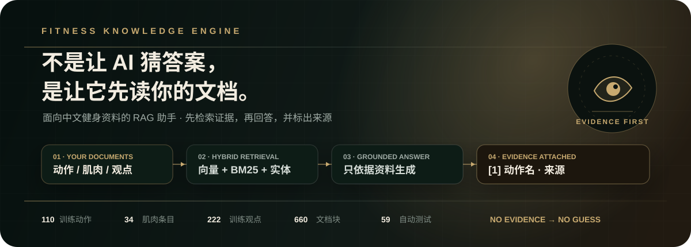
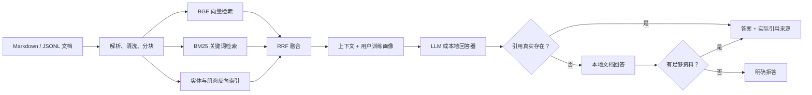

<div align="center">
  

  <h1>健身文档 RAG 助手</h1>

  <p><strong>让 AI 先读你的文档，再回答问题。</strong></p>
  <p>回答带引用 · 没资料就拒答 · 不把模型猜测伪装成训练事实</p>

  <p>
    
    
    
    
    <a href="https://github.com/Z2155335950/fitness-rag/actions/workflows/ci.yml">
      
    </a>
  </p>

  <p>
    <a href="#30-秒看懂">30 秒看懂</a> ·
    <a href="#一次真实使用">使用示例</a> ·
    <a href="#核心能力">核心能力</a> ·
    <a href="#快速开始">快速开始</a> ·
    <a href="#它是怎么工作的">技术架构</a>
  </p>
</div>

> [!IMPORTANT]
> 这是一个可运行的训练知识助手，不是医疗诊断产品。伤病、疼痛和康复问题应寻求医生或康复师评估。

## 它到底是什么？

普通聊天机器人可能“知道很多”，但你无法确认它这次回答来自哪里。

这个项目换了一个思路：

> **先把你的训练资料检索出来，再让模型组织语言。**
> 每个事实结论都要引用资料编号；资料中没有答案时，它宁可承认不知道。

你可以把它理解成一个读过你健身文档的 AI：

```text
你的问题
   ↓
从动作库、肌肉库和训练观点中找证据
   ↓
模型只根据找到的资料回答
   ↓
返回答案 + [1] [2] 来源
```

## 30 秒看懂

| 用户问什么 | 系统怎么处理 | 用户看到什么 |
| --- | --- | --- |
| 文档里明确有答案 | 检索证据，生成回答，校验引用 | 回答 + `[1]` + 可展开来源 |
| 只找到部分资料 | 只总结已有内容 | 有依据的部分 + 缺失说明 |
| 文档里没有答案 | 不调用模型凭空补全 | “当前文档没有足够依据” |
| 模型引用了不存在的来源 | 丢弃模型回答，切换到本地文档答案 | 可核验的降级回答 |

## 一次真实使用

**你问：**

```text
平板杠铃卧推主要练什么？
```

**它回答：**

```text
平板杠铃卧推主要训练胸大肌整体，三角肌前束和肱三头肌辅助发力。
动作时肩胛骨下沉贴紧凳面，脚踩实地面，下放至乳头附近，小臂尽量垂直地面。[1]
```

**它同时给出：**

```text
[1] 平板杠铃卧推 · 文档片段 · action_平板杠铃卧推
```

如果你问一个库里没有的动作：

```text
库里有没有凤凰深蹲？
```

它不会编造收录记录，而会明确告诉你当前文档没有该动作。

## 为什么不是“套壳聊天框”？

| 普通文档聊天 | 这个项目 |
| --- | --- |
| 把整篇文档塞进提示词 | 多路检索后只选择相关证据 |
| 回答看起来对即可 | 强制要求事实回答携带有效引用 |
| 模型忽略文档也可能继续回答 | 无引用时自动回退，无资料时拒答 |
| 只答知识问题 | 同时维护目标、经验、频率、器械和计划状态 |
| 服务重启后对话丢失 | SQLite 持久化，并按照浏览器身份隔离 |
| 无法定位回答依据 | API、页面和历史记录都保存实际引用来源 |

## 核心能力

### 1. 文档优先，而不是模型自由发挥

- Markdown / JSONL 文档解析与结构化
- BGE 向量检索 + BM25 + 精确实体 + 肌肉反向索引
- RRF 融合、字段回查、器械和身体部位过滤
- `<documents>` 注入边界，文档中的提示词指令不会执行
- `[1]`、`[2]` 引用校验，无效引用自动回退

### 2. 真正面向训练场景

- 110 个训练动作、34 个肌肉条目、222 条训练观点
- 动作别名、肌肉别名、身体部位和器械条件识别
- 动作详情、肌肉找动作、条件筛选、开放语义问题
- 计划类问题按肌群、目标和训练风格生成多查询检索
- 缺少目标、频率或器械时主动追问

### 3. 没有模型 Key 也能运行

- 支持 DeepSeek、OpenAI 及其他 OpenAI 兼容服务
- 模型不可用时使用本地文档回答
- 本地训练计划同样带文档引用
- DeepSeek 专属 `thinking` 参数不会误发给其他供应商

### 4. 原型也要把工程做扎实

- FastAPI 网页与 JSON API
- SQLite 会话、消息、反馈和检索事件
- 签名 HttpOnly Cookie 用户隔离
- 删除会话时同步清理反馈和分析数据
- 59 个自动测试 + GitHub Actions
- 索引健康检查、原子建库、UTF-8 CLI

## 它是怎么工作的



### 引用防线的四层保护

1. **提示层**：资料放在 `<documents>` 中，并声明为不可信数据。
2. **格式层**：事实段和计划动作必须使用 `[n]` 标注来源。
3. **校验层**：引用编号必须真实存在；无引用或越界引用直接回退。
4. **返回层**：API 和 UI 只展示本次回答实际引用的片段。

## 快速开始

### 环境

- Python 3.11
- 首次建库需要联网下载 `BAAI/bge-small-zh-v1.5`

```powershell
git clone https://github.com/Z2155335950/fitness-rag.git
Set-Location fitness-rag
python -m pip install -r requirements.txt
```

仓库不上传 BM25、Chroma 和模型缓存，首次运行需要构建索引：

```powershell
python -m src.index.build_index
```

配置模型：

```powershell
Copy-Item .env.example .env
```

```dotenv
LLM_PROVIDER=deepseek
LLM_API_KEY=your-api-key
LLM_MODEL=deepseek-flash
LLM_BASE_URL=https://api.deepseek.com
```

不配置 Key 也可以运行本地文档助手。

启动网页：

```powershell
.\start.ps1
```

如果 PowerShell 禁止执行本地脚本：

```powershell
python -m uvicorn app:app --host 127.0.0.1 --port 8000
```

打开 `http://127.0.0.1:8000`。

## 可以直接体验的问题

```text
深蹲怎么做？
平板杠铃卧推主要练哪里？
家里没哑铃怎么练胸？
凯圣王怎么看平板卧推的 RPE？
我每周能练 3 天，想增肌，家里有哑铃，给我一份计划。
库里有没有莱尔斯卧推？
```

最后一个问题用于观察系统是否会拒答，而不是编造知识库内容。

## 技术细节

<details>
<summary><strong>知识库与检索</strong></summary>

- 主文档：动作、肌肉、人物观点
- 辅助文档：294 条动作字段 chunk
- 总文档块：660
- 检索通道：BGE、BM25、精确实体、肌肉反向索引
- 字段命中后回查完整动作，不让辅助 chunk 替代实体主文档
- 建库先写临时目录，全部成功后提交；失败保留现有索引

</details>

<details>
<summary><strong>对话、历史与隐私</strong></summary>

- 每个浏览器获得独立匿名身份，不依赖客户端可伪造的 `user_key`
- 会话列表、读取、改名、删除、反馈和分析全部按身份隔离
- 删除会话会同步删除检索事件和反馈
- 公网部署建议配置 `APP_SECRET_KEY`
- HTTPS 部署设置 `APP_COOKIE_SECURE=true`

</details>

<details>
<summary><strong>命令行与 API</strong></summary>

```powershell
python -m src.cli "深蹲怎么做"
python -m src.cli "家里没哑铃怎么练胸" --json
```

主要接口：

```text
POST   /api/chat
GET    /api/chat/conversations
GET    /api/chat/{session_id}
DELETE /api/chat/{session_id}
POST   /api/feedback
GET    /api/chat/analytics/summary
GET    /health
```

事实类回答会返回 `sources` 和 `citations`。例如：

```json
{
  "citations": [
    {
      "ref": 1,
      "id": "action_平板杠铃卧推",
      "name": "平板杠铃卧推"
    }
  ]
}
```

</details>

<details>
<summary><strong>测试与评测</strong></summary>

```powershell
python scripts/check.py
python data/eval/run_eval.py --write-report
```

自动检查包括：

- Python 编译
- 59 个单元与 API 测试
- 页面 JavaScript 语法检查
- 依赖一致性
- 索引 manifest 和 BM25 完整性
- 建库失败不覆盖现有索引

当前 20 条检索题主要用于开发回归，不等于正式的模型质量认证。

</details>

## 项目目录

```text
data/raw/         原始训练文档
data/parsed/      结构化动作、肌肉、观点和别名
data/eval/        检索与答案质量评测
src/parsers/      文档解析与观点清洗
src/query/        实体识别与意图路由
src/retrieval/    多路召回与融合
src/index/        向量、BM25、反向索引和健康检查
src/chat/         对话、引用、计划、历史、分析和 API
src/rag.py        单轮检索与知识回答
app.py            FastAPI 网页入口
tests/            自动测试
```

## 边界与后续方向

- 当前难度字段主要由动作名称和类型启发式推断
- 部分人物观点仍标记为 `needs_source_link`，不应视作已核验来源
- 训练动作和观点用于知识参考，不替代专业教练或医疗评估
- 后续重点是来源补全、引用语义一致性、真实用户测试和更完整的回答质量评测

---

<div align="center">
  <strong>Evidence first. Answer second.</strong><br>
  先找证据，再回答。
</div>
